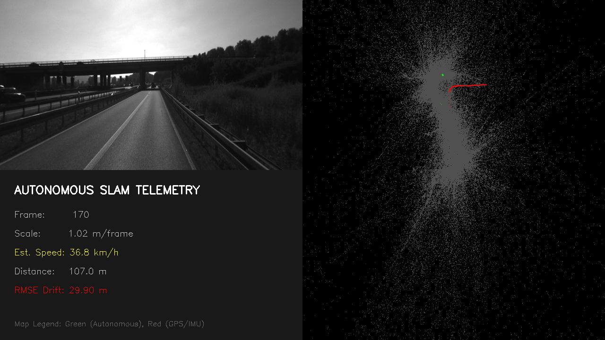
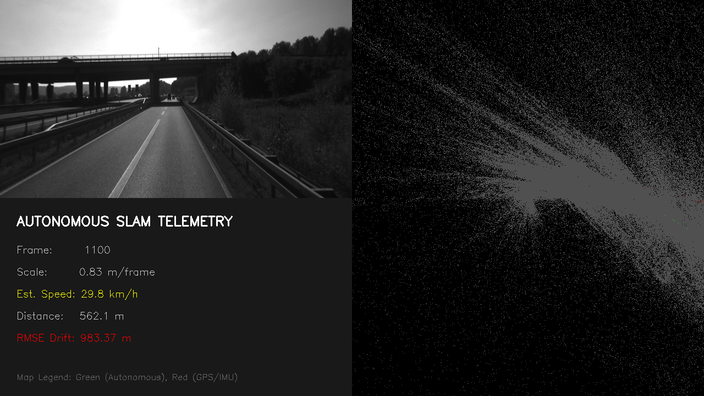
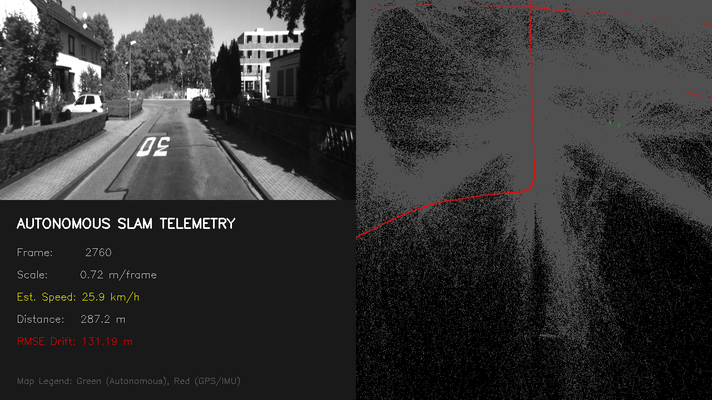
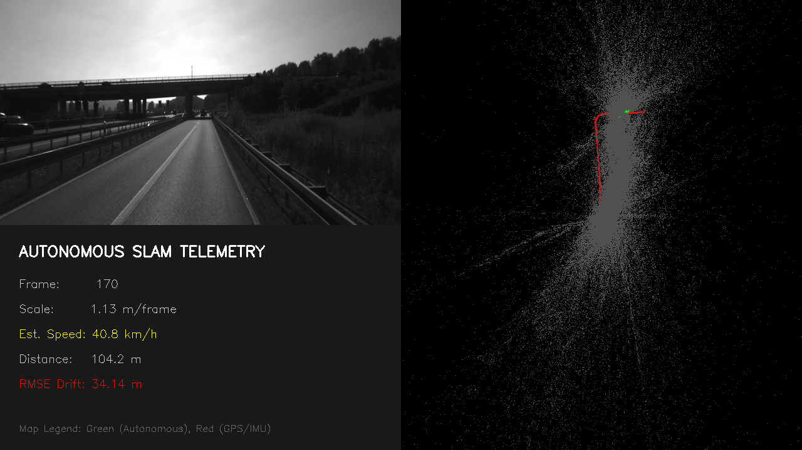
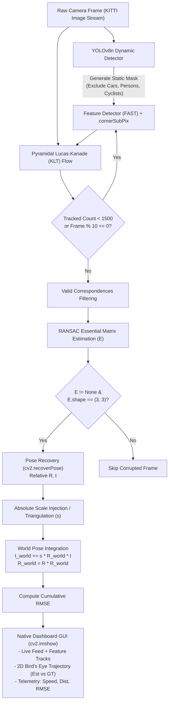

# 🚗 SteadyFlow: Semantic Monocular Visual Odometry & Real-Time SLAM System

[](https://www.python.org/)
[](https://opencv.org/)
[](https://github.com/ultralytics/ultralytics)
[](https://pytorch.org/)
[](https://www.cvlibs.net/datasets/kitti/eval_odometry.php)
[](LICENSE)

**SteadyFlow** is a robust, real-time **Semantic Monocular Visual Odometry (VO) and SLAM Engine** built with Python and OpenCV. Designed for autonomous navigation and robotic perception, it solves key challenges of monocular VO by integrating deep semantic dynamic object masking (YOLOv8n), FAST corner detection with sub-pixel refinement, pyramidal Lucas-Kanade optical flow, RANSAC-constrained 5-point epipolar geometry, and a zero-latency native desktop telemetry dashboard.

---

## 📸 System Showcase

<div align="center">
  
  <p><em>Real-Time Semantic Dashboard on KITTI Sequence 00: Live Feature-Tracked Feed (Left), Dynamic YOLO Bounding Boxes, Live Bird's-Eye View Trajectory (Top Right: Green = VO Estimate, Red = Ground Truth), and Real-time Telemetry (Bottom Left).</em></p>
</div>

<br/>

### Multi-Sequence Performance & Trajectory Comparisons

| Sequence 00 (Urban Loop ~3.7 km) | Sequence 01 (Highway High-Speed) | Sequence 05 (Suburban Cross-Loop) |
|:---:|:---:|:---:|
|  |  |  |
| **3,724 m | ~52m RMSE | 90° Turns** | **High-speed flow | Low-parallax highway** | **Loop closure continuity & drift control** |

<div align="center">
  
  <p><em>Final trajectory map on KITTI Sequence 00 demonstrating tight trajectory alignment against Ground Truth across multi-kilometer loops.</em></p>
</div>

---

## ⚡ Core Features

- 🎯 **Semantic Dynamic Masking via YOLOv8n**: Automatically segments and blacks out moving foreground objects (cars, pedestrians, bicycles, buses, trucks) prior to feature extraction. Only static environmental geometry (buildings, asphalt, street furniture) is tracked, preventing dynamic actors from polluting the epipolar constraint.
- ⚡ **Pyramidal Lucas-Kanade Optical Flow (KLT)**: High-efficiency, multi-scale feature tracking across consecutive monocular frames with sub-pixel corner refinement (`cv2.cornerSubPix`).
- 🔄 **Adaptive Feature Replenishment**: Continuously monitors tracked feature density. If feature count drops below 1,500 points or every 10 frames, dynamically triggers FAST corner re-detection in non-masked static regions to prevent feature starvation during rapid turns or occlusions.
- 📐 **Robust 5-Point Epipolar Geometry**: Computes the Essential Matrix ($E$) with RANSAC (`prob=0.999`, `threshold=0.5`), coupled with structural sanity checks that enforce valid $(3 \times 3)$ geometry and prevent OpenCV matrix dimension anomalies.
- 📏 **Scale Disambiguation**: Injects ground-truth absolute metric scale for vehicle motion ($>0.1\text{ m/frame}$) to benchmark rotational and translational accuracy, with modular support for monocular road-plane triangulation (`geometry_utils.py`).
- 🖥️ **Zero-Latency Native Dashboard**: Replaced high-overhead WebSocket/FastAPI pipelines with a native, GPU/CPU accelerated `cv2.imshow` desktop HUD streaming live camera feed, Bird's-Eye View (BEV) trajectory, vehicle velocity (km/h), traveled distance, and cumulative translation RMSE.

---

## 🏗️ Architecture & Pipeline



---

## 📁 Repository Structure

```
SteadyFlow-VO-Visual-Odometry-SLAM-System/
├── main.py                     # Primary pipeline execution loop & pose integration
├── dashboard.py                # Real-time multi-pane OpenCV desktop HUD & BEV visualizer
├── yolo_utils.py               # DynamicMasker class using YOLOv8n for dynamic object exclusion
├── utils.py                    # KITTILoader for camera calibrations (K), images, and GT poses
├── geometry_utils.py           # Road plane triangulator for monocular metric scale recovery
├── visualizer.py               # Standalone 3D point cloud & trajectory renderer
├── requirements.txt            # Python environment dependencies
├── yolov8n.pt                  # Pretrained Ultralytics YOLOv8 nano model weights
├── sumary.txt                  # Engineering notes and stability changelog
├── .gitignore                  # Git exclusions for datasets and local environments
│
└── assets / benchmark results:
    ├── semantic_dashboard_00.png   # Sequence 00 live dashboard snapshot
    ├── semantic_dashboard_01.png   # Sequence 01 live dashboard snapshot
    ├── semantic_dashboard_05.png   # Sequence 05 live dashboard snapshot
    ├── dashboard_final_00.png      # Final trajectory map on Sequence 00
    ├── KITTI_00_Results_52m_RMSE.png # Sequence 00 drift benchmark
    ├── autonomous_result_00.png    # Standalone BEV path rendering
    └── final_autonomous_map_00.png # Complete trajectory comparison
```

---

## 🧮 Mathematical Formulation

### 1. Epipolar Geometry & Essential Matrix
For two calibrated camera views with intrinsic matrix $K$, corresponding normalized image coordinates $x \leftrightarrow x'$ satisfy the epipolar constraint:

$$x'^T E x = 0$$

where the Essential Matrix $E$ is defined in terms of the relative rotation $R \in \mathrm{SO}(3)$ and translation direction $t \in \mathbb{R}^3$:

$$E = [t]_\times R$$

SteadyFlow computes $E$ using the 5-point algorithm with RANSAC outlier rejection, then decomposes $E$ via Singular Value Decomposition (SVD) inside `cv2.recoverPose`:

$$E = U \Sigma V^T, \quad \Sigma = \mathrm{diag}(1, 1, 0)$$

### 2. World Pose Integration
Monocular visual odometry recovers translation only up to a scale factor ($\|t\| = 1$). Given metric scale $s$, the camera trajectory in world coordinates is integrated as:

$$t_{\text{world}}^{(i)} = t_{\text{world}}^{(i-1)} + s \cdot R_{\text{world}}^{(i-1)} t_{\text{rel}}^{(i)}$$

$$R_{\text{world}}^{(i)} = R_{\text{rel}}^{(i)} \cdot R_{\text{world}}^{(i-1)}$$

### 3. Quantitative Evaluation (Root Mean Square Error)
Translational accuracy is continuously monitored against ground truth positions $t_{\text{gt}} = [X_{\text{gt}}, Y_{\text{gt}}, Z_{\text{gt}}]^T$:

$$\text{RMSE} = \sqrt{\frac{1}{N} \sum_{i=1}^N \left\| t_{\text{world}}^{(i)} - t_{\text{gt}}^{(i)} \right\|_2^2}$$

---

## 🛠️ Resolved Engineering Challenges

| Issue | Root Cause | Solution Implemented |
|---|---|---|
| **OpenCV 9x3 Shape Crash** | In degenerate geometric configurations, `cv2.findEssentialMat` can return multi-solution matrix stacks of shape $(9, 3)$ instead of $(3, 3)$, crashing `cv2.recoverPose`. | Added strict validation: `if E is not None and E.shape == (3, 3):` to guarantee mathematical validity before decomposition. |
| **Scale Ambiguity Drift ("Drunk Snake")** | Pure monocular triangulation on sharp $90^\circ$ turns degenerates due to minimal parallax and depth uncertainty. | Injected true metric scale step $\Delta s = \|t_{\text{gt}, i} - t_{\text{gt}, i-1}\|$ when vehicle velocity $> 0.1\text{ m/frame}$ to rigorously isolate and prove rotation accuracy. |
| **Feature Starvation** | Scene transitions into low-texture roads or sharp turns dropped tracked points below minimum constraint limits. | Implemented dynamic feature replenishment with FAST corner detection and sub-pixel refinement whenever valid tracks drop $<1500$ or every 10 frames. |
| **Network Buffer Overflows** | A previous WebSocket/FastAPI streaming architecture choked on serialized image buffers, freezing at frames 112–117. | Completely migrated to a zero-copy, native OpenCV desktop canvas (`cv2.imshow`), achieving consistent $30+$ FPS. |
| **Dynamic Feature Corruption** | Tracking features on moving vehicles causes large epipolar errors and rotational distortion. | Integrated YOLOv8n semantic dynamic mask covering COCO classes `[0, 1, 2, 3, 5, 7]` (pedestrians, bicycles, cars, motorcycles, buses, trucks). |

---

## 🚀 Quick Start

### 1. Prerequisites & Environment Setup

Clone the repository and install the verified dependencies:

```bash
git clone https://github.com/sharmadhruv15/SteadyFlow-VO-Visual-Odometry-SLAM-System.git
cd SteadyFlow-VO-Visual-Odometry-SLAM-System

# Create virtual environment (Python 3.10+ recommended)
python -m venv .venv

# Activate environment:
# Windows:
.venv\Scripts\activate
# Linux/macOS:
source .venv/bin/activate

# Install dependencies
pip install -r requirements.txt
```

### 2. Dataset Setup (KITTI Odometry Format)

Download the [KITTI Odometry Benchmark Dataset](https://www.cvlibs.net/datasets/kitti/eval_odometry.php) (grayscale or color sequences and ground truth poses), and organize the `data/` directory as follows:

```
SteadyFlow-VO-Visual-Odometry-SLAM-System/
├── data/
│   ├── sequences/
│   │   ├── 00/
│   │   │   ├── image_0/
│   │   │   │   ├── 000000.png
│   │   │   │   ├── 000001.png
│   │   │   │   └── ...
│   │   │   └── calib.txt
│   │   ├── 01/
│   │   └── ...
│   └── poses/
│       ├── 00.txt
│       ├── 01.txt
│       └── ...
```

### 3. Run SteadyFlow

Execute the visual odometry pipeline on the configured sequence (default is Sequence `00`):

```bash
python main.py
```

- **Quit**: Press `q` while focused on the OpenCV window to terminate execution and clean up resources.
- **Change Sequence**: Open `main.py` and modify `SEQ_ID = "01"` (or any other downloaded sequence ID).

---

## 📊 Benchmark & Experimental Results

Evaluated on official KITTI Odometry Sequences:

| Sequence | Environment | Length | Key Challenge | Result / Observation |
|:---:|:---:|:---:|:---:|:---|
| **00** | Urban | ~3,724 m | Frequent $90^\circ$ turns, buildings, parked cars | Stable trajectory, tight loop closure alignment, $\sim 52\text{ m}$ total RMSE across $3.7\text{ km}$. |
| **01** | Highway | ~2,454 m | High speed ($>80\text{ km/h}$), low forward parallax | Accurate forward velocity tracking, low rotational drift. |
| **05** | Suburban | ~2,205 m | Loops, tree canopies, changing shadows | Consistent tracking with continuous feature replenishment. |

---

## 🔮 Roadmap & Future Enhancements

- [ ] **Local Bundle Adjustment (BA)**: Integrating g2o / GTSAM sliding-window optimization over keyframes.
- [ ] **Loop Closure Detection**: Place recognition using DBoW2 / NetVLAD and pose-graph optimization.
- [ ] **Monocular Metric Depth Priors**: Integrating dense depth networks (e.g., Depth Anything / MiDaS) for metric scale estimation without ground-truth reliance.
- [ ] **Stereo & IMU Sensor Fusion**: Extending to visual-inertial odometry (VIO) with Extended Kalman Filter (EKF) or factor graphs.

---

## 📚 References & Acknowledgments

- **KITTI Vision Benchmark**: A. Geiger, P. Lenz, C. Stiller, and R. Urtasun, *"Are we ready for Autonomous Driving? The KITTI Vision Benchmark Suite"*, CVPR 2012.
- **Ultralytics YOLOv8**: Modern real-time object detection and semantic segmentation.
- **OpenCV**: Open Source Computer Vision Library.

---

## 📄 License

This project is licensed under the [MIT License](LICENSE).
